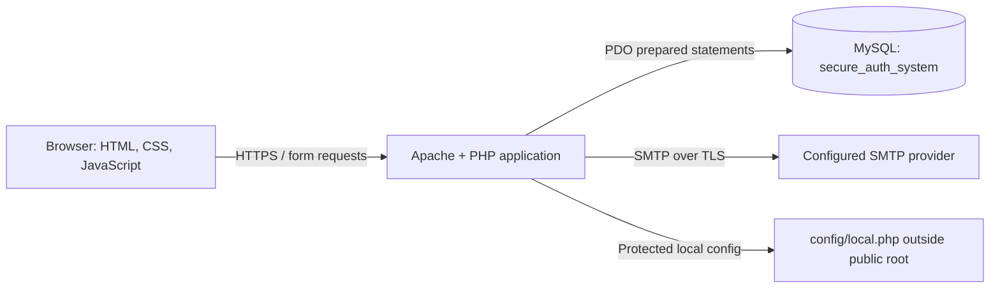
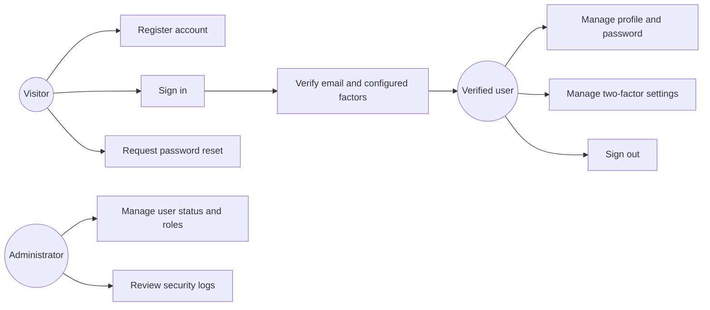
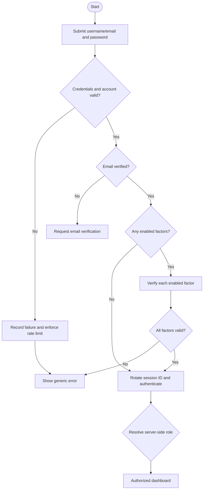
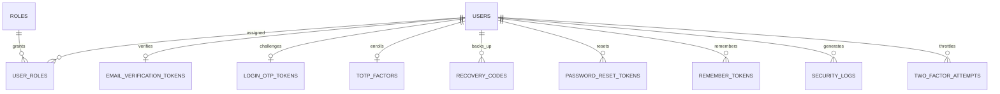

# Secure Login and Authentication System — Project Report

> Replace the bracketed student/course details and update the testing section with results observed on your own configured XAMPP installation. Do not claim a test passed until you have performed it.

## Title page

**Project:** Design and Implementation of a Secure Login and Authentication System with Email Verification, Role-Based Authorization, and Two-Factor Authentication  
**Student:** [Your name]  
**Department / course:** [Department and course]  
**Supervisor:** [Lecturer]  
**Date:** [Submission date]

## Abstract

This project implements a database-backed authentication application using PHP, MySQL, HTML, CSS, and vanilla JavaScript. It demonstrates account registration, one-time email verification, protected password storage, optional time-based authenticator and email second factors, role-checked pages, password recovery, persistent login tokens, CSRF protection, and security-event logging. Server-rendered PHP performs validation and authorization; MySQL persists accounts and security state; PHPMailer delivers email through an explicitly configured SMTP provider. Email delivery and test claims are conditional on the actual local SMTP/runtime configuration.

## 1. Introduction

Web applications must establish the identity of a user and limit each action to the permissions assigned to that identity. Weak passwords, unverified accounts, reusable reset credentials, and checks performed only in the browser can lead to unauthorized access. This project demonstrates several server-side controls in a small XAMPP-hosted system suitable for classroom study.

## 2. Problem statement

A visual-only login form does not authenticate against persistent accounts, prove email ownership, protect password-reset flows, or enforce roles on the server. The problem addressed is how to build an understandable local application that demonstrates these essential controls while preserving a manageable beginner workflow.

## 3. Objectives

1. Store account and role data in MySQL using prepared statements and relational constraints.
2. Verify email ownership with expiring, single-use six-digit codes.
3. Hash passwords and recovery credentials; protect OTPs and persistent-login validators at rest.
4. Require email OTP for every sign-in and support RFC 6238 authenticator codes as an additional factor, with recovery codes only for the authenticator.
5. Enforce role authorization on protected PHP pages and actions.
6. Demonstrate CSRF defense, session rotation, login throttling, password recovery, and safe security logs.
7. Provide a responsive, accessible navy/teal interface.

## 4. Scope and requirements

### In scope

Registration, sign-in, verification, password reset, profile/password updates, mandatory email OTP, optional additional TOTP, recovery codes, administrator account/status management, student/general/admin dashboards, and recent security logs.

### Out of scope

Social sign-in, multi-tenant administration, production email queues, email-address change workflows, high-availability deployment, dedicated distributed rate-limiting infrastructure, and independent penetration testing.

### Functional requirements

The application must register accounts with a safe General User role; verify email; authenticate username/email plus password and an emailed OTP on every login; require TOTP as an additional factor when enabled; support password recovery and logout; and reject disallowed role actions on the server.

### Non-functional requirements

Use HTTPS in production; keep credentials outside the web root; use server-side validation, CSRF tokens, output escaping, prepared SQL, expiring one-use credentials, secure cookies, meaningful feedback, and audit events that exclude secrets.

## 5. Architecture

PHP serves pages in `public/`. Shared helpers in `app/` own sessions, CSRF checks, password operations, TOTP, mail, database access, and authorization. MySQL stores users, role assignments, factor state, one-use credentials, remember tokens, rate-limit records, and audit events.

## 6. Use cases

## 7. Authentication flow

## 8. ER diagram and database design

`database/schema.sql` is the authoritative schema. `users` and `roles` have a many-to-many assignment through `user_roles`. Per-account verification/OTP/factor state is keyed to `users`; recovery, reset, remember, and audit rows are also associated with accounts. Login throttling uses keyed hashes of identifiers/IP addresses. Foreign keys, unique constraints, and indexes enforce identity and lookup requirements.

## 9. Security implementation

- Passwords are transformed with a server-only HMAC pepper and then hashed using Argon2id if PHP supports it, otherwise `PASSWORD_DEFAULT`; verification uses `password_verify()`. PHP generates a salt per password hash. Pepper and salt are different: the salt is stored with each hash; the pepper is an application secret stored outside the database.
- Email OTPs are mandatory for every sign-in. They are generated with `random_int`, stored as keyed hashes, expire in five minutes, have five verification attempts, and use one-minute resend cooldowns. An enabled TOTP or recovery code cannot substitute for email verification.
- TOTP is RFC 6238 with 30-second codes. Its secret is stored encrypted using libsodium and the protected `app_key`. Recovery codes are random, stored as password hashes, and consumed once.
- Password reset tokens use 256 bits of randomness, are stored as SHA-256 hashes, expire after 30 minutes, and are invalidated after use. Reset requests are generic to reduce account enumeration and limited by IP.
- Remembered-session authentication is disabled. The legacy schema remains for compatibility, but existing remember-token rows are not used to restore sessions and are retained rather than deleted by this change.
- Session IDs rotate after complete authentication. Protected writes require CSRF tokens; database queries use PDO prepared statements; rendered user-controlled text is escaped.
- Login and second-factor failures are rate-limited. Role checks are performed by PHP for each dashboard/administrative action. Security logs omit credentials, OTPs, recovery codes, and TOTP secrets.

## 10. Implementation and operation

Follow the root `README.md` for XAMPP, Composer, SQL import, `config/local.php`, and SMTP setup. The configuration example is `config/local.example.php`; keep the real file private. For a classroom administrator, register/verify a test account and assign its administrator role through a trusted phpMyAdmin session, not a public registration field.

The authenticator setup displays a secret for manual enrollment. Add it to the authenticator app as a time-based SHA-1 six-digit code with a 30-second period, enter the current code to confirm, and save all recovery codes privately.

## 11. Testing and actual results

The execution environment used to prepare this project did not have PHP, Composer, XAMPP, or MySQL available, so runtime tests and SMTP delivery have **not been run**. Record observations after following the root README:

| Scenario | Expected result | Actual result / date |
|---|---|---|
| Register valid account | Account is stored with General User role; verification required | Not run |
| Duplicate username/email | Registration rejected without creating a second user | Not run |
| OTP valid / expired / reused / brute force | Valid code works once; expiry and attempt limit are enforced | Not run |
| SMTP working / missing / rejected | Real email arrives on success; failure is communicated truthfully | Not run |
| Sign in with username and email | Correct credentials proceed; wrong credentials fail generically | Not run |
| TOTP and recovery code | Correct current code works; recovery works once | Not run |
| Mandatory email OTP and legacy remember cookie | Every new sign-in requires email OTP; an old remember cookie cannot restore a session | Not run |
| Password reset | Valid link changes password once; expiry/reuse rejected | Not run |
| Role tampering / direct URL / forged POST | Unauthorized actions return 403 or are rejected | Not run |
| CSRF and XSS probes | Missing CSRF fails; submitted markup is rendered inertly | Not run |

Do not replace "Not run" with "Pass" unless you performed and recorded the corresponding test.

## 12. Limitations

The system is intended for education and has not received an independent audit. Database-backed rate limiting is not a substitute for production-grade distributed controls. Email delivery depends on an external SMTP provider and correct TLS/DNS configuration. Invalid legacy email correction is restricted to the Platform Super Admin, requires password re-entry and an out-of-band identity check, and forces the new address through email verification; this route still needs an authenticated integration test. The app key must be backed up securely because TOTP ciphertext cannot be recovered if the key is lost. No automated integration suite was executed in the current tool environment.

## 13. Conclusion

The project demonstrates the principal authentication lifecycle and its supporting database relationships in a local PHP/MySQL application. It emphasizes the separation of presentation from server-side authorization, correct one-time credential handling, and truthful reporting of email/test outcomes.

## 14. Recommendations

Run all checklist cases in XAMPP; add automated tests and a deployment-specific threat model; add account/email change and session-revocation workflows; configure HTTPS and a least-privileged database account; use monitored mail delivery; and obtain a qualified security review before any real-user deployment.

## References

1. PHP Documentation, “Password Hashing,” https://www.php.net/manual/en/faq.passwords.php
2. PHP Documentation, `password_hash()` and `password_verify()`, https://www.php.net/manual/en/function.password-hash.php and https://www.php.net/manual/en/function.password-verify.php
3. OWASP Cheat Sheet Series, “Authentication Cheat Sheet,” https://cheatsheetseries.owasp.org/cheatsheets/Authentication_Cheat_Sheet.html
4. OWASP Cheat Sheet Series, “Cross-Site Request Forgery Prevention Cheat Sheet,” https://cheatsheetseries.owasp.org/cheatsheets/Cross-Site_Request_Forgery_Prevention_Cheat_Sheet.html
5. RFC 6238, “TOTP: Time-Based One-Time Password Algorithm,” https://www.rfc-editor.org/rfc/rfc6238
6. PHPMailer documentation, https://github.com/PHPMailer/PHPMailer
7. MySQL Reference Manual, “InnoDB and Foreign Keys,” https://dev.mysql.com/doc/refman/8.0/en/create-table-foreign-keys.html
